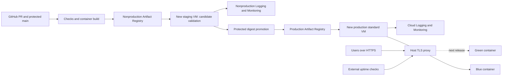

# geometrydash-ui: independent GCP DevOps deployment plan

> **Current implementation:** production-only Terraform, GitHub Actions, monitoring and rollback are now in the repository. Follow [PRODUCTION_SETUP.md](PRODUCTION_SETUP.md) for setup. Dev/staging configuration is intentionally inactive; the multi-environment and HA sections below describe future expansion. No account resources have been provisioned by writing these files.

**Purpose:** build a reproducible, observable deployment that demonstrates practical DevOps engineering, fits a controlled trial budget, and can grow into a highly available service.

**Reviewed:** 2026-10-15. This is an implementation specification, not an applied deployment. geometrydash-ui receives its own infrastructure. The supplied `meshseg-worker` Terraform belongs to an unrelated project and is background context only.

## 1. Recommended approach

Create dedicated Google Cloud projects for **geometrydash-ui nonproduction** and **geometrydash-ui production**. Provision new resources within them. Package the UI as a small, immutable container and promote the tested image through staging and production, with monitoring and a tested rollback procedure.

Implement in three steps:

1. **Create a new nonproduction VM to prove the delivery process.** Add monitoring, deploy a staging UI, and demonstrate a failed deployment and rollback. Develop locally.
2. **Create a small standard production VM in the dedicated production project.** Give it its own network, identities, registry, Terraform state, and domain. Run staging only when needed. This is the recommended everyday trial setup.
3. **Create a two-zone HA profile for resilience demonstrations or sustained production.** Put a regional managed instance group behind an HTTPS load balancer. Keep it running only when the remaining credit and quotas support it.

The useful demonstration is that you can recreate the system, explain its cost, detect failure, recover, and scale it predictably. A single-host setup can demonstrate release engineering; it cannot survive loss of that host.

## 2. Resource ownership and isolation

The other project's VM, bucket, network, service accounts, startup script, and Terraform state stay outside this application's deployment. Do not import them, deploy onto them, or grant the new application access to them.

| Boundary | geometrydash-ui design |
| --- | --- |
| Projects | New `geometrydash-ui-nonprod-UNIQUE` and `geometrydash-ui-prod-UNIQUE` projects; names are examples |
| Compute | New staging VM and new production VM/MIG; no use of `meshseg-worker` |
| Networking | A new custom VPC, subnet, firewall rules, and IPs in each environment project |
| Connectivity | No Shared VPC, peering, VPN, or other network link to the unrelated project |
| Runtime identities | New service accounts scoped to this application's environment resources |
| CI access | New deployment identities and federation providers; no roles in the unrelated project |
| Image registry | New Artifact Registry repository in each environment project |
| Terraform | New root modules and independent, private state buckets in the new projects |
| Monitoring | New dashboards, alerts, log collection, and notification configuration scoped to this application |
| Storage | New private state/release storage as needed; no reuse of the other project's data bucket |
| Billing | The new projects may use the same trial billing account; this shares credit, not application infrastructure |

The UI is static React/Vite/Three.js and reads imported geometry in a browser worker. It currently needs no server-side geometry processor, database, or geometry-data bucket. A future remote-processing feature would receive its own authenticated API and job resources within this application's architecture.

Use Debian 12, OS Login, IAP administration, Shielded VM settings, and dedicated runtime identities as design patterns when provisioning the new VMs. Keep their bootstrap configuration in this repository. Use **standard** production capacity; optional Spot staging can be interrupted and must be restartable. [Spot VM behavior](https://docs.cloud.google.com/compute/docs/instances/spot)

## 3. Trial budget: what is realistic?

The current trial provides **$300 of credit for 90 days**, subject to eligibility and product restrictions. Credits are shared by resources billed to that account; creating a staging project does not create another credit allocation. An unupgraded trial stops resources when credit or time expires. Upgrading retains unexpired credit but enables charges outside that credit. [Google Cloud trial](https://docs.cloud.google.com/free/docs/free-cloud-features)

The trial also restricts quota increases. Check both steady-state capacity and temporary rollout capacity before choosing HA.

### Deployment profiles

| Profile | Resources | What it demonstrates | Availability boundary |
| --- | --- | --- | --- |
| A — initial lab | One new nonproduction VM in the new nonproduction project, with remote monitoring | CI, image promotion, blue/green switch, rollback | Lab only; one host and no independent production deployment |
| B — recommended trial operation | One new standard production VM + one new on-demand staging VM, in separate new projects | Environment separation, repeatable deployment, secure identity, recovery | One production VM remains a single point of failure |
| C — HA exercise / growth | Two new standard production VMs across two zones + global HTTPS load balancer; separate new staging VM | Load balancing, health checks, rolling updates, autohealing, failure drill | Handles an instance/zone failure at reduced capacity; not a whole-region outage |

For profile B, an `e2-small` is a candidate for serving this static app; choose `e2-medium` if measured memory use from the OS, proxy, containers, and Ops Agent needs it. Build and run Chromium tests on CI runners, not the production VM. The browser performs geometry rendering. [E2 machine characteristics](https://docs.cloud.google.com/compute/docs/general-purpose-machines)

### Example budget, with explicit assumptions

These are **planning calculations, not a quote for your resources**. Assume Linux, low traffic, 730 running hours/month, no paid OS license, a hypothetical small-VM rate of **$0.02/hour**, and **$0.10/GiB-month** for the chosen disk. Replace these two inputs with the new projects' region-specific calculator values. [Compute pricing](https://cloud.google.com/products/compute/pricing), [disk pricing](https://cloud.google.com/compute/disks-image-pricing)

| Cost item | Profile B example | Profile C example |
| --- | ---: | ---: |
| Production compute | 1 × 730 × $0.02 = $14.60 | 2 × 730 × $0.02 = $29.20 |
| Production disks, 20 GiB each | $2.00 | $4.00 |
| Production VM public IPv4, if retained for outbound access | $3.65 | $7.30 |
| Global load-balancer forwarding rules | $0 | $18.25 |
| Separate staging: 40 compute hours, 20 GiB disk, retained static IPv4 | ~$6.45 | ~$6.45 |
| Planning allowance for modest logs, registry/state storage, DNS, transfer, and short rollout overlap | $10 | $10 |
| **Illustrative geometrydash-ui monthly total** | **~$37** | **~$75** |
| **Rough 3-month geometrydash-ui total** | **~$111** | **~$225** |

These estimates cover this application's new resources. If the unrelated project uses the same trial billing account, its charges also reduce the available credit; account for them in the billing-account runway without linking the deployments. Domain registration and GitHub runner overages are separate; the $10 allowance is not a usage cap. Traffic or log volume can exceed it.

Public IPv4 attached to a standard VM is listed at $0.005/hour; a retained static address remains billable while its VM is stopped. Addresses detached from resources can cost more. The load-balancer figure uses $0.025/hour for the first five forwarding rules; processing and transfer are additional. [Network/IP pricing](https://cloud.google.com/vpc/network-pricing), [load-balancer pricing](https://cloud.google.com/load-balancing/pricing)

A realistic runway calculation is:

```text
safe daily spend = (remaining trial credit - reserve) / days remaining

new platform allowance per day
  = safe daily spend - existing account spend per day

Example:
  $180 remaining, 60 days left, $36 reserve
  safe daily spend = ($180 - $36) / 60 = $2.40
  unrelated projects on the same billing account cost $1/day
  new platform allowance = $1.40/day ≈ $42 per 30 days

The ~$37 profile fits this example; the ~$75 profile does not.
```

Start with a 20% reserve. Use the last 7 days of actual account spend, not the VM's sticker price. A short HA exercise can be affordable even when leaving HA running for the rest of the trial is not.

### Cost controls to implement

- Set an **alerts-only budget** across the billing account and per-environment budgets at 50%, 80%, and 100% thresholds. Budget alerts do not stop spending. [Budget behavior](https://docs.cloud.google.com/billing/docs/how-to/budgets)
- Label resources with `app`, `environment`, `owner`, `managed_by`, and `cost_center`.
- Schedule staging start/stop with an independent timeout or shutdown schedule; CI cancellation must not leave it running indefinitely.
- Keep an explicit expiry for the HA exercise. Delete its load balancer and temporary resources when finished; stopping its VMs does not stop every charge.
- Retain current and rollback image digests, then clean old registry versions. Start cleanup policies in dry-run mode. [Artifact cleanup](https://docs.cloud.google.com/artifact-registry/docs/repositories/cleanup-policy)
- Check credit balance and expiry weekly, and before each HA exercise. Put a post-trial decision date on the calendar.
- Do not count on the ongoing Free Tier to cover this architecture: its eligible VM, disk, and region limits differ from trial credit. Choose and cost the new disks explicitly; do not assume `pd-balanced` receives the standard-disk allowance.

## 4. Environments and topology

Use **dev, staging, and production** as separate lifecycle environments. Blue and green are two release slots inside one environment, not two production environments.

| Environment | Purpose | Initial placement | Access / data |
| --- | --- | --- | --- |
| Dev | Interactive UI development and local tests | Local machine and isolated CI runners | Local fixture files |
| Staging | Validate the exact production candidate | New scheduled VM in the new nonproduction project | IAP tunnel or authenticated HTTPS; sample data only |
| Production | Stable viewer | New standard VM in the new production project; later regional MIG | Public HTTPS UI; dedicated runtime identity |

Provision both projects independently from the unrelated project, with explicitly configured project IDs and provider aliases. Both may use the same trial billing account. If project quota prevents creating both immediately, start with the new nonproduction project and profile A, then add the production project when available. Keep project-specific monitoring scopes and IAM bindings within this application.

Profile B:



Bind application slots to localhost, for example `127.0.0.1:8081` and `127.0.0.1:8082`. Only the host proxy exposes ports 80/443. Use a real domain and automated certificate renewal for public production. For private staging, test through IAP and perform separate public TLS checks after production promotion.

Use isolated hosted CI runners; allow cloud deployment only from reviewed, trusted branches. The unrelated project's VM is outside the CI and deployment architecture.

## 5. Terraform for the new projects

### Start with independent state and ownership

Create new Terraform root modules for this application in this repository. The unrelated project's Terraform/state, resource addresses, human SSH enrollment, and startup script are outside their scope.

Before provisioning:

1. Choose unique project IDs, region, staging zone, production zone(s), and resource names for geometrydash-ui.
2. Create the new projects and attach the intended billing account using an authorized bootstrap identity.
3. Create a private, versioned Terraform state bucket in each new project, then configure its GCS backend. Keep bootstrap state and recovery documented.
4. Set the Google provider's project explicitly in every root module. Restrict CI identities to these new projects.
5. Review the plan: every resource must belong to this application, with no imports, data-source lookups, IAM grants, or networking references to the unrelated project.

Keep state buckets separate from optional application/release storage. Runtime accounts receive no access to state. Pin Terraform/provider versions, commit `.terraform.lock.hcl`, and keep tfstate/plan files out of public artifacts. The GCS backend provides locking. [GCS state backend](https://developer.hashicorp.com/terraform/language/backend/gcs)

### APIs

Create API enablement resources in each new environment root:

```hcl
provider "google" {
  project = var.project_id # Only this environment's new geometrydash-ui project.
  region  = var.region
}

resource "google_project_service" "apis" {
  project = var.project_id
  for_each = toset([
    "compute.googleapis.com",
    "storage.googleapis.com",
    "iap.googleapis.com",
    "iam.googleapis.com",
    "iamcredentials.googleapis.com",
    "sts.googleapis.com",
    "artifactregistry.googleapis.com",
    "logging.googleapis.com",
    "monitoring.googleapis.com",
  ])
  service            = each.key
  disable_on_destroy = false
}
```

Enable additional billing/Cloud Build APIs only if implementing those features. API enablement alone does not install software or configure monitoring.

### New VM identity and monitoring authorization

Define a dedicated runtime identity in each new environment root, for example:

```hcl
resource "google_service_account" "web" {
  project      = var.project_id
  account_id   = "geometrydash-ui-web"
  display_name = "geometrydash-ui web runtime"
  depends_on   = [google_project_service.apis]
}

resource "google_project_iam_member" "web_observability" {
  for_each = toset([
    "roles/logging.logWriter",
    "roles/monitoring.metricWriter",
  ])
  project = var.project_id
  role    = each.key
  member  = "serviceAccount:${google_service_account.web.email}"
}
```

Attach that account to the **new** web VM with an appropriate access scope:

```hcl
# Inside this environment's new google_compute_instance resource.
service_account {
  email  = google_service_account.web.email
  scopes = ["https://www.googleapis.com/auth/cloud-platform"]
}
```

The scope does not grant all-project permissions by itself; IAM controls access. Install/configure the Ops Agent through this application's version-controlled bootstrap and verify logs and metrics arrive in the corresponding new project. [Ops Agent authorization](https://docs.cloud.google.com/monitoring/agent/ops-agent/authorization), [agent installation](https://docs.cloud.google.com/monitoring/agent/ops-agent/installation)

### Identity boundaries

| Identity | Required access | Boundary |
| --- | --- | --- |
| Environment web runtime | Artifact Registry Reader on its own image repository; log writer; metric writer | No Terraform state access or image publication |
| CI image publisher | Artifact Registry Writer on the new nonproduction repository | No SSH/root access or infrastructure administration |
| Image promoter | Reader on the new nonproduction repository and Writer on the new production repository | Copies the tested image; no access to the unrelated project |
| Staging deployer | IAP/OS Login access to the new staging VM plus its approved deploy command | New nonproduction project only |
| Production deployer | IAP/OS Login access to the new production VM plus its approved deploy command | New production project only |
| Environment Terraform operator | Permissions needed by its managed resources and state backend | Its new environment project only |
| Project bootstrap operator | Approved project creation and billing attachment | Separate from routine application release credentials |

Create an Artifact Registry repository in each environment project. Grant `roles/artifactregistry.reader` to that environment's runtime at repository scope and configure Docker's supported credential helper to use the attached VM identity. Production pulls from its production repository. [Compute Engine image pulls](https://docs.cloud.google.com/artifact-registry/docs/integrate-compute)

Promotion copies the approved OCI manifest and layers into the production repository without rebuilding. Use a digest-preserving copy and verify the destination digest matches the tested source before deployment. Keep each environment's current and previous images in its own repository so runtime/recovery does not require access to the other environment.

For production deployment, use OS Login plus a tightly scoped, root-owned deployment helper through `sudo`. Access to Docker's socket or `osAdminLogin` effectively grants host administration; if choosing that simpler trial model, limit it to dedicated web VMs and document it explicitly. Scope `serviceAccountUser` to the target VM's runtime service account. Provision IAP access and firewall rules in the new project; the unrelated project's access settings are not inherited. [IAP permissions](https://docs.cloud.google.com/iap/docs/using-tcp-forwarding)

### Repository layout

Use separate root modules and backends for nonproduction and production. Each environment owns its VPC, subnet, VM/MIG, image repository, runtime/deploy identities, federation configuration, monitoring, and state. A bootstrap root handles project creation and initial backend setup.

Proposed layout:

```text
infra/
  bootstrap/             # New projects, state buckets, initial identities
  environments/
    nonprod/             # New staging infrastructure and its backend
    prod/                # New production infrastructure and its backend
  modules/
    web-vm/
    web-mig/
    observability/
ops/
  nginx/
  systemd/
  deploy.sh
  rollback.sh
  smoke.mjs
  runbooks/
.github/workflows/
  checks.yml
  release.yml
  infrastructure.yml
  drift.yml
Dockerfile
.dockerignore
```

These paths are implementation deliverables, not files already created by this guide.

## 6. Build and supply-chain contract

The runtime image serves the Vite `dist/` tree with an unprivileged Nginx process. Node.js, test tools, source files, cloud credentials, and private geometry do not belong in the runtime image.

Build requirements:

- `npm ci` from the committed lockfile.
- `npm test` and `npm run build`; the latter already runs TypeScript checking.
- Pin base images by digest and refresh them through reviewed dependency updates.
- Include `version.json` with the Git commit and CI run identifier, and an OCI source/revision label.
- Build once, test that image, then push and promote its immutable digest.
- Scan application/build dependencies and the final image; publish an SBOM and provenance alongside the release record.
- Set resource limits, run without root, drop unused capabilities, and use a read-only root filesystem with explicit temporary paths where Nginx needs them.
- Keep the previous known-good image locally on the VM and protected from registry cleanup.

Define the following serving behavior:

| Request | Expected behavior |
| --- | --- |
| `/`, `/results`, `/import`, `/guide`, `/meshes/:id` | HTML with correct SPA routing |
| `/assets/*` | Real JS/CSS/worker files; correct MIME; immutable caching for hashed names |
| `/sample/*` | JSON/fixtures; revalidate unversioned files |
| `/version.json` | Release identity; no stale caching |
| `/readyz` | 200 only when the server can read the required release files |
| Missing asset or JSON | 404, not a catch-all HTML response |

Do not use `npm run dev` or `vite preview` as the public production server. Publish only the application build and its intentional public fixtures.

**Existing-tab compatibility:** the app creates a new worker on each import. An old browser tab can request a previous hashed worker URL after a deployment. Retain prior hashed assets in the served release artifact for a defined window, such as the last 10 releases/7 days, and test an old tab with browser caching disabled. Automatically reloading the UI can discard the user's in-memory imported workspace.

## 7. CI/CD pipelines

Use GitHub Actions for this GitHub repository and authenticate to the new environment projects with Workload Identity Federation. Create federation providers and deployment identities for this application. Match the trust condition to the numeric repository/owner IDs, protected branch, workflow, and environment. Only release/deploy jobs receive `id-token: write`; PR jobs receive no cloud credentials. [Workload Identity Federation](https://docs.cloud.google.com/iam/docs/workload-identity-federation-with-deployment-pipelines)

GitHub runner billing is separate from GCP trial credit. If all CI execution must be billed in GCP, use Cloud Build for the same stages and a dedicated build identity; keep one authoritative release pipeline.

### Application pipeline

| Trigger/stage | Required work | Release gate |
| --- | --- | --- |
| Pull request | Install, dependency audit, unit tests, type check, build, container build, browser tests, image scan | No deployment; all required checks pass |
| Trusted merge to main | Produce one tested image, SBOM/provenance, publish digest and release manifest | Associate results with that digest |
| Staging | Start environment, deploy digest, run hosted checks and browser journeys | Candidate passes with the production server/config |
| Production promotion | Verify successful staging, copy the image into the new production repository, and verify the same digest | Protected GitHub environment; optional human reviewer |
| Production deployment | Prepare inactive slot, verify, switch traffic, verify publicly | Failed verification restores previous slot |
| After deployment | Record release evidence; observe error rate; stop scheduled staging | Alert if rollout, rollback, or cleanup fails |

At minimum, run the existing checks:

```bash
npm ci
npm audit --audit-level=high
npm test
npm run build
npx playwright install --with-deps chromium
```

The current Playwright config starts a development server. Add `playwright.ci.config.ts` for a production build or the candidate container:

```ts
import { defineConfig } from '@playwright/test';
import base from './playwright.config';

const target = process.env.E2E_BASE_URL;

export default defineConfig({
  ...base,
  forbidOnly: true,
  retries: 1,
  workers: 1,
  reporter: [['list'], ['html', { open: 'never' }]],
  use: {
    ...base.use,
    baseURL: target || 'http://127.0.0.1:5174',
    trace: 'retain-on-failure',
  },
  webServer: target ? undefined : {
    command: 'npm run preview -- --host 127.0.0.1 --port 5174 --strictPort',
    url: 'http://127.0.0.1:5174',
    reuseExistingServer: false,
  },
});
```

For the image gate, start the candidate container on a runner port and set `E2E_BASE_URL` to that port. For private staging, create an IAP tunnel and use the forwarded port; public production gets a separate HTTPS/certificate check. This preserves the existing Chromium software-WebGL flags.

Required browser coverage includes sample loading, deep-link refresh, worker imports, STL rendering, original JSON export, and responsive layouts. There is currently no lint script or coverage threshold: implement those with an agreed baseline before adding them as required checks. Do not mask a failing check with unconditional retries or `continue-on-error`.

### Infrastructure pipeline

- PRs: `terraform fmt -check -recursive`, initialized-provider `terraform validate`, lint/security policy checks, and a cost review.
- Run credentialed plans only for trusted changes; provider/data-source code is executable. Keep untrusted fork checks credential-free.
- Produce a saved plan from the reviewed commit for the correct state. Protect production apply with the infrastructure environment and apply that reviewed plan.
- If the plan is stale or inputs changed, regenerate and review it. Never apply a different current branch than the one reviewed.
- Run scheduled drift detection with `terraform plan -detailed-exitcode`: 0 means no change, 2 means changes, and 1 means an error. Report drift rather than applying automatically.
- Separate infrastructure changes from routine image releases. In the MIG profile, define exactly one owner for the active instance-template pointer so Terraform and release automation do not revert each other's changes.

Pin workflow actions to reviewed commit SHAs, retain test reports, set job timeouts, and serialize releases per environment. Allow cancellation of superseded PR checks; do not interrupt a production switch with cancellation.

## 8. Blue/green deployment and rollback on one VM

Use two containers and a host Nginx TLS proxy. One slot serves traffic; the other receives the candidate image. Store the current/previous image digest, slot, proxy configuration checksum, commit, and deployment time in a root-owned release journal.

The deployment helper must be idempotent and implement this transaction:

1. Acquire a host deployment lock. Validate the requested digest and registry allowlist.
2. Capture the active slot/configuration and write an in-progress journal record.
3. Pull the candidate by digest; leave the active container running.
4. Start the inactive slot on its localhost port with resource limits and restart policy.
5. Poll `/readyz` with a deadline. Verify `version.json`, the sample manifest, real JS/worker responses, MIME types, and deep-link HTML.
6. Generate the proxy configuration in a temporary file. Validate it with `nginx -t` before activating it.
7. Atomically replace the active configuration and perform a graceful Nginx reload.
8. Verify the public URL, TLS, release identity, and a browser smoke journey.
9. If verification fails, restore the saved configuration, reload, and verify the old release. Mark the deployment failed even if rollback succeeds.
10. If verification passes, mark the candidate active and retain the previous slot/image for rollback. Release the lock and record the event.

Nginx reloads can gracefully replace workers, but that alone does not guarantee application continuity. Test requests during switching and allow old connections to drain before stopping a previous container. [Nginx reload behavior](https://nginx.org/en/docs/control.html)

A Docker restart policy restarts a crashed process; an unhealthy container does not necessarily restart just because it has a health check. Use an explicit supervisor/watchdog policy and alert on repeated restarts.

### Recovery cases

| Failure | Recovery action | Target to prove |
| --- | --- | --- |
| Candidate fails before switch | Remove candidate; current release keeps serving | No traffic sent to the bad release |
| Candidate fails after switch | Restore previous proxy config/image and verify | Rollback under 5 minutes |
| CI runner disconnects during switch | Host helper/journal completes or recovers independently | No unknown active release |
| Host reboots | Systemd starts proxy and correct recorded slots | Recover under 10 minutes in the lab |
| Host is lost | Recreate from Terraform/bootstrap and retained digest | Measure restore time; initial target under 30 minutes |
| Optional Spot staging is preempted | Recreate staging and redeploy the candidate digest | Production remains independent |

Make rollback available as a protected, parameterized workflow accepting an **approved previous digest**, not an arbitrary image string. Never rebuild an old commit during an emergency rollback.

Keep release evidence and registry images outside the serving VM in this application's environment resources. Back up certificates/configuration securely or document certificate reprovisioning; avoid storing TLS private keys in Terraform state. Recreate web hosts from their own Terraform/bootstrap and retained releases.

## 9. Monitoring that demonstrates operations

Use **Cloud Monitoring + Cloud Logging + the Ops Agent**. They provide a small operational footprint and remain available when the VM is down. A separate Prometheus/Grafana VM is optional later if demonstrating those products is itself a requirement.

Create dashboards and alert policies as Terraform resources. Include environment and instance filters so a stopped staging VM does not page as a production outage.

| Signal | Initial collection / threshold | Action |
| --- | --- | --- |
| Public availability | HTTPS probe every minute from at least 3 locations; confirm status and expected content | Alert after repeated failures from at least 2 locations |
| Release correctness | `version.json` matches the deployed digest's commit; sample JSON loads | Fail deployment or investigate drift |
| Server errors | 5xx ratio >2% for 5 minutes, with a minimum request count | Check release/proxy logs; roll back if correlated |
| Latency | p95 above a measured baseline for 10 minutes | Check contention, egress, and capacity |
| CPU / memory | Sustained CPU >80%; memory >85% for 10 minutes | Inspect proxy/container resource use, leaks, or sizing |
| Disk | >80% used or projected exhaustion | Clean retained layers/logs according to policy |
| Process / agent | Restart loop, missing metrics, stopped proxy | Recover and investigate |
| Billing | Forecast beyond the remaining-credit plan | Stop optional resources and adjust the plan |
| Certificate / trial expiry | Alerts before expiry | Renew or make the explicit post-trial decision |

Emit structured proxy/application-deployment logs with status, duration, environment, release, and instance. Exclude uploaded geometry, filenames, credentials, and raw imported payloads. Configure log rotation on the VM and exclusions/retention in Cloud Logging.

The current pricing page includes 50 GiB/project/month of ordinary Logging ingestion, 150 MiB/billing-account/month for eligible billable metric ingestion, non-chargeable Google Cloud metrics, and one million uptime-check executions/project/month. Three locations × two checks × one-minute intervals is roughly 259,200 executions in 30 days. Browser synthetic monitors have different pricing; do not treat them as ordinary uptime checks. Verify alerting pricing when implementing because its published start date has changed. [Observability pricing](https://cloud.google.com/products/observability/pricing)

Suggested service objectives:

- Track 99.9% monthly UI availability as a goal, not an achieved SLA.
- Detect an outage within 5 minutes.
- Restore a bad release within 5 minutes after initiating rollback.
- Record deployment frequency, failed-deployment percentage, and measured recovery time.
- Keep browser geometry errors separate from server availability.

A healthy `/readyz` cannot prove WebGL or import behavior. Run browser journeys on each release and periodically while production is expected to be available.

## 10. Scaling to real high availability

For profile C, replace the standalone production VM with:

- A **regional managed instance group** distributed across **two selected zones**.
- At least two **standard** VMs, one per zone, each able to handle the expected normal load alone.
- Immutable instance templates referencing a pinned OS image/bootstrap and container digest.
- A global external Application Load Balancer with managed TLS.
- Load-balancer health checks and a separately tuned, less aggressive autohealing policy.
- Cloud Logging/Monitoring and the same release identity convention.
- Explicit maximum instance count and cost limits in the capacity plan.

A regional MIG can spread instances across zones; it does not protect from a whole-region outage. Losing one of two instances removes half the provisioned capacity, so test the survivor under the intended traffic. [Regional MIG design](https://docs.cloud.google.com/compute/docs/instance-groups/regional-migs)

### Network and bootstrap

Allow backend application ingress only from the documented load-balancer/health-check sources for the chosen load balancer, and administration through IAP. Target only the new production web instances using their dedicated identity or tags. [Health checks and firewall requirements](https://docs.cloud.google.com/load-balancing/docs/health-check-concepts)

For the simplest trial profile, backend VMs can retain external IPs for outbound package/image access with inbound firewall rules restricted to the load balancer and IAP; the budget above includes these IPs. As the system matures, remove external IPs and use Private Google Access for supported Google APIs plus baked OS images or an explicitly budgeted egress path. Do not remove internet access while leaving startup scripts dependent on `apt` or public container registries.

### Rolling releases

Use a rolling update with `maxUnavailable = 0`. For a regional group spanning two zones, choose a supported surge configuration, such as a fixed `maxSurge = 2`; a fixed nonzero regional surge must accommodate the number of zones. Check production-project quota for the temporary extra instances, nonproduction quota for staging, and billing-account credit for all projects' usage. [Managed instance rolling updates](https://docs.cloud.google.com/compute/docs/instance-groups/rolling-out-updates-to-managed-instance-groups)

Wait for candidate readiness and successful traffic checks before progressing. Autohealing is not application-version rollback: a broken template can recreate the same broken release. Roll back by selecting the previous immutable template through the same update process.

Terraform should own infrastructure topology. Choose either Terraform-driven release-template updates or an explicitly delegated release field managed by CI; document that ownership and include it in drift checks.

### HA acceptance exercise

1. Start continuous probes and a bounded load test; record the normal baseline.
2. Remove or stop one managed instance in the test deployment.
3. Confirm the load balancer routes to the survivor and observe replacement/autohealing.
4. Record failed requests, recovery time, and capacity on the survivor.
5. Deploy an intentionally unhealthy candidate and verify rollout rejection/rollback.
6. Confirm a valid release rolls out without a material availability drop.
7. Tear down the temporary profile, verify no orphaned IP/LB/disk resources remain, and record the cost.

Removing one VM demonstrates instance failure handling. A zonal-outage claim requires a zone-specific traffic/failure exercise and evidence; do not label a single process restart as a zone-failure test.

Add multi-region serving, CDN, queues, and backend services when measured load or recovery requirements justify them. Kubernetes is a valid later learning objective, but the release, identity, observability, and recovery practices above transfer to it.

## 11. Portfolio evidence and completion criteria

| Capability | Evidence to retain |
| --- | --- |
| Infrastructure as code | Reviewed plan, repeatable staging creation, documented state ownership |
| CI quality | Failed PR blocked; unit/browser reports; image scan and SBOM |
| Environment promotion | Same image digest in staging and production |
| Deployment safety | Failed candidate receives no live traffic; recorded successful switch |
| Rollback | Before/after release IDs and measured recovery time |
| Observability | Dashboard, delivered alert, correlated logs, recovery notification |
| Security | IAM matrix, restricted federation, protected state storage, scoped network rules |
| Project isolation | Plans reference only the new projects; no IAM/network/state dependencies on the unrelated project |
| Cost engineering | Calculator assumptions, actual billing trend, staging schedule, cleanup evidence |
| Availability | Failure-drill results and explicit single-VM / zone / region limitations |
| Operations | Concise incident report and a runbook another person can follow |

Suggested implementation order:

- [ ] Choose new project IDs, region, VM sizing, and independent resource names.
- [ ] Record remaining credit/expiry and total daily spend across projects on the billing account.
- [ ] Bootstrap the new projects, private state buckets, and independent Terraform roots.
- [ ] Verify plans and CI identities reference only this application's new projects.
- [ ] Add monitoring authorization/agent configuration and verify one alert end to end.
- [ ] Create the image/registry, release manifest, and production-serving configuration.
- [ ] Add CI checks against the actual container.
- [ ] Implement staging, deployment locking/journal, blue/green switching, and rollback.
- [ ] Create new staging and standard production hosts with separate networks, registries, and runtime identities.
- [ ] Enable protected promotion, public HTTPS checks, and retention policies.
- [ ] Measure a rollback and a host-rebuild drill.
- [ ] Run the optional HA profile after confirming peak quota and budget.
- [ ] Record results and decide what remains running after the exercise/trial.

**Validation status:** the existing app's 24 unit tests and production build passed during the initial documentation review. This guide specifies new, independent infrastructure; no resources from the unrelated project have been inspected, changed, or adopted. Project creation, billing, Docker deployment, monitoring collection, IAM, rollback, and HA behavior still require implementation and live validation.
